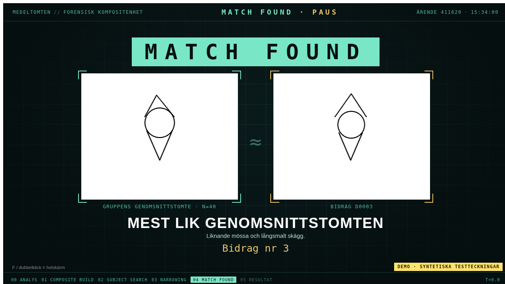

# Faktisk verifiering av V2

Körd på Linux 2026-11-23. V2 bygger på V1-commit `f44eb31` i den fortfarande omergade draft PR #2.

## Automatiska kontroller

| Kontroll | Faktiskt resultat |
|---|---|
| `.venv/bin/python -m pytest backend/tests` | 55 passerar på 280,72 s: 34 befintliga V1-tester och 21 V2-tester. |
| `.venv/bin/python -m pytest backend/tests/test_ai.py -q` | 21 passerar; omkört efter de sista V2-ändringarna. |
| `npm run typecheck` | Passerar. |
| `npm run lint` | 0 fel, samma två `set-state-in-effect`-varningar som i V1:s kontrollpanel. |
| `npm run build` | Passerar; byggda appen användes i webbläsartestet. |
| `.venv/bin/python scripts/check_v2_ui.py <utdatamapp>` | Passerar i Chromium, kontroll- och projektorfönster, 40 syntetiska bidrag, 80 parjämförelser. Inga JavaScript-fel eller externa webbförfrågningar. |
| `git diff --check`, Python compileall | Passerar. |

FastAPI/Starlettes nya TestClient-version ger dessutom en deprecationsvarning om `httpx` kontra `httpx2`.
Testerna passerar med installerade beroenden; inget byte av produktionsklient krävs för detta uppdrag.

V2-testerna injicerar en **scriptad testprovider**, inte en AI-modell. Produktionsadapterns dokumenterade
Responses- och Images-REST-kontrakt kontrolleras separat med `httpx.MockTransport`, inklusive bearer-header,
base64-bilder, strikt schema, två bildordningar, JSON-baserad bildgenerering och lokal PNG-avkodning.
Detta är kontrakttester, inte en verifiering mot leverantörens server.

Verifierade V2-egenskaper:

- Alla 40 respektive 75 individuella ID:n observeras; batchar om sju ger avsiktligt ojämna sista batchar.
  Summering ger 36/40 respektive 68/75 huvudmotiv, och minoritetens tillbehör får ett sällsynt attribut.
  Generatorns verkliga request-underlag är majoritetsbaserat och saknar vald vinnare/ranking.
- Alla inkluderade original jämförs två gånger med exakt den godkända referensens bytes/hash.
  Referensklassificering och parjämförelser sparas; ordningsoberoende deterministisk sortering och
  semantisk efterbehandling testas. Ingen relativ batchranking används.
- Bilden kan godkännas/genereras om. En ännu inte godkänd version byter inte referens; godkännande av en
  annan version invaliderar matchningen även om testprovidern levererar samma PNG igen. Gamla PNG-filer finns kvar.
- Saknad nyckel, okänd provider, 401, 429, nätfel, timeout, vägran, ofullständigt svar, schemafel, fel ID:n,
  duplicerade observationer, ogiltig bild och SVG i stället för PNG hanteras utan låtsasresultat.
- Retry är begränsad. En genereringstimeout gör inte ett andra betalt genereringsanrop automatiskt.
  Observationer och parjämförelser återanvänds från kontrollpunkter. Serveromstart och avbrott testas.
- Pågående jobb blockerar bildändringar; ändrat underlag gör AI-stegen inaktuella. En manipulerad referensfil
  blockerar showstart. Override kräver notering och bevarar modellens ursprungliga ranking i admin/export.
- Show, resultat, export, omladdning och repris fungerar när varje försök att konstruera en AI-provider
  avsiktligt kastar fel. Före reveal saknas vinnare, score, rank, godkännande, förklaring och provenance i
  presentationspayloaden. Shuffle använder ett sparat privat frö, inte den publika bildhashen.
- Zip innehåller godkänd referens, rapporter, ursprungliga deltagarbilder, normaliserade bilder och separat legacy-diagnostik.
- V1-testerna täcker fortsatt faktisk import/ArUco/normalisering/legacy-analys med 40, 75 och 100 syntetiska
  fotograferade mallar, granskning/manuella hörn, score, exporter och presentationsstyrning.

## Webbläsare och visuell layout

UI-testet klickar genom konsensus → godkännande → generering → bildgodkännande → matchning → manuellt
val av en annan toppkandidat med notering → godkännande → show. Det kör alla fem showfaser, paus, fasbyte,
omladdning före reveal, reducerad rörelse och repris med AI-anrop spärrade. HTTP-trafik utanför localhost
avvisas och hade gjort testet underkänt. Kandidat-/referensbildernas laddning kontrolleras före skärmbilden.
Skärmbilder av kontrollpanel, rekonstruktion, sökning, reveal och resultat har granskats.

Nedan är en **layoutverifiering med syntetiska testbilder och scriptad testprovider**. Den illustrerar
varken faktisk AI-generering eller perceptuell kvalitet. Den visar att faktiskt vald kandidat (D0003) och
referensen får rätt plats, storlek och etikett. Även resultatvyn leder med den manuellt godkända matchen;
admin/export behåller modellens ranking oförändrad.



Återskapa UI-testet (valfritt testberoende, inte nödvändigt på eventdatorn):

```bash
.venv/bin/pip install -r backend/requirements-ui.txt
.venv/bin/python -m playwright install chromium  # eller ange CHROMIUM_PATH till befintlig Chromium
cd frontend && npm run build && cd ..
.venv/bin/python scripts/check_v2_ui.py /tmp/capchristmas-v2-ui
```

Testet använder en tillfällig datakatalog och ändrar inga riktiga sessioner. Resultatmappen innehåller
`report.json` och PNG-skärmbilder. Ingen testprovider kan väljas via appens konfiguration.

## Inte verifierat – krävs före skarp fest

- **Ingen OPENAI_API_KEY eller annan AI-nyckel fanns tillgänglig. Inga riktiga AI-anrop gjordes.**
  Modellåtkomst för användarens konto, saldo, faktisk debitering, live-latens och API-kontraktets praktiska
  beteende på kontot behöver verifieras med serverns `.env` och en riktig provkörning.
- **Inga riktiga handritade provteckningar fanns.** Vi har inte visuellt verifierat att en verklig
  genererad bild blir en sammanhängande tomte eller att modellen väljer den perceptuellt bästa matchen.
  Majoritetsregler/underlag och godkännandesteg är testade; modellens följsamhet är inte det.
- Repetera med 40–75 heterogena riktiga ritningar: huvudmajoritet + några helkroppsritningar, sällsynta
  tillbehör, olika pennstyrka/stil/placering. Granska och regenerera vid behov; jämför topp fem mot den
  faktiskt godkända bilden. Spara rapport/override och bedöm förberedelsens tid/kostnad.
- Windows/PowerShell, fysisk utskrift, riktig kamera och fysisk projektor är inte verifierade här.
  Kör eventchecklistan på den riktiga eventdatorn, inklusive repris med nätverket avstängt.

Konfiguration, prisantaganden, metod och versions-/invalideringsregler finns i [V2.md](V2.md).

## Färdigbyggt paket utan Node på användardatorn (2026-11-24)

`scripts/build-package.py` bygger frontend på byggdatorn och paketerar spårad källkod samt
`frontend/dist`. Installationsskripten hoppar över npm när dessa assets finns och installerar
enbart produktionsberoenden för Python. PowerShell-skriptet stoppar också vid misslyckade underkommandon.

Faktiskt verifierat på Linux: nytt frontendbygge; ZIP med HTML/JS/CSS och instruktioner;
uppackning i tillfällig katalog; start av den paketerade FastAPI-appen utan byggsteg;
HTTP 200 för kontrollpanel, alla dess byggda JS/CSS-assets och health/session-API.
ZIP kontrollerad för att inte innehålla `.env`, sessionsdata, `.venv` eller `node_modules`.
`bash -n scripts/install.sh` passerar. Windows-installationsskriptet har inte körts i denna miljö.
